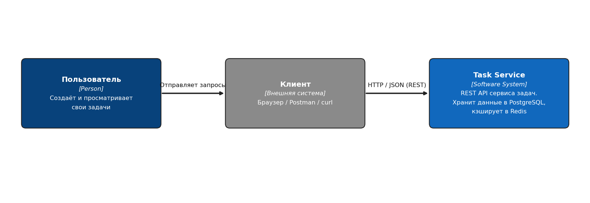
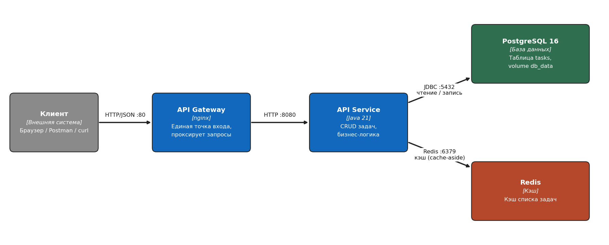
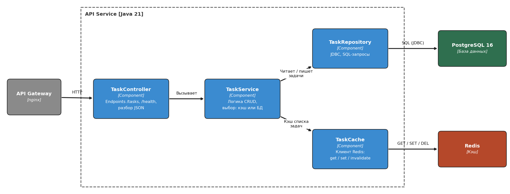

# Архитектура: Task Service (C4)

Редактируемый источник: [`architecture.drawio`](architecture.drawio) (3 страницы: Context, Container, Component, открывается в app.diagrams.net).
Экспорт: `c4-1-context.png`, `c4-2-container.png`, `c4-3-component.png`.

## Система
Task Service это REST API для ведения списка задач: пользователь создаёт, просматривает, обновляет и удаляет свои задачи. Данные хранятся в PostgreSQL, список задач кэшируется в Redis.

**Основной сценарий:** пользователь создаёт задачу (`POST /tasks`) и затем просматривает список (`GET /tasks`).

## C4 Level 1 - Context

Пользователь работает через клиент (браузер, Postman, curl), клиент обращается к Task Service по HTTP/JSON.

## C4 Level 2 - Container

| Контейнер | Технология | Роль |
|---|---|---|
| API Gateway | nginx | Единая точка входа, проксирует запросы к API Service |
| API Service | Java 21 | Логика CRUD задач |
| PostgreSQL | postgres:16, volume `db_data` | Постоянное хранение задач (таблица `tasks`) |
| Redis | Redis | Кэш списка задач |

Направление: Клиент → API Gateway → API Service → PostgreSQL и Redis.

## C4 Level 3 - Component (API Service)

| Компонент | Роль |
|---|---|
| TaskController | HTTP-endpoints `/tasks`, `/health`, разбор и формирование JSON |
| TaskService | Логика CRUD: читает из кэша, при промахе из БД; при изменениях сбрасывает кэш |
| TaskRepository | JDBC-запросы к PostgreSQL |
| TaskCache | Клиент Redis: get / set / invalidate |

## Почему Redis
Список задач читается значительно чаще, чем меняется. Redis хранит готовый результат `GET /tasks` (подход cache-aside): при чтении сначала проверяется кэш, при промахе данные берутся из PostgreSQL и кладутся в кэш с TTL. При `POST`, `PUT`, `DELETE` кэш сбрасывается. Это снижает нагрузку на PostgreSQL и ускоряет ответы.

## Примечание
Схема целевая. В текущей реализации код API находится в одном классе `Main`, а API Gateway и Redis ещё не добавлены в `docker-compose.yml`.
